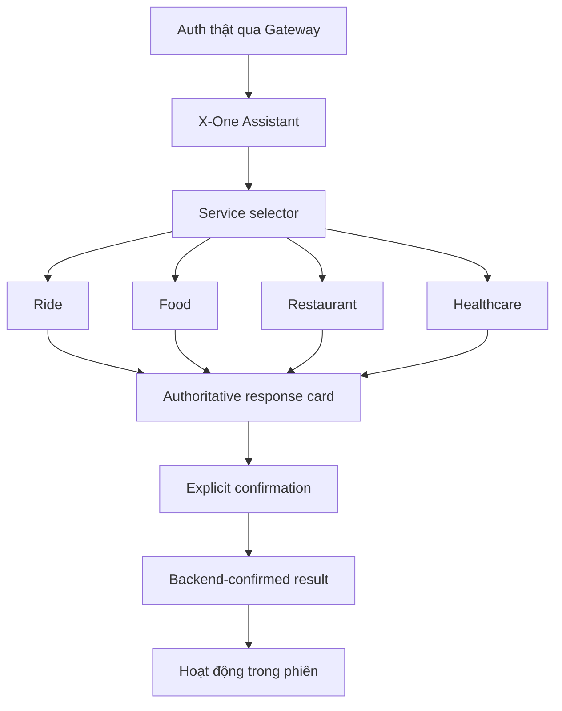

# X-One Web — Wireframe & UI Flow

Tài liệu này mô tả pre-demo frontend trong `apps/web/`. Web là một client mỏng
gọi NestJS API Gateway tại `http://localhost:3000`; không gọi Agent, domain service
hoặc database trực tiếp. Bốn capability hiển thị trong UI là Ride, Food,
Restaurant và Healthcare.

## Information architecture



App shell có tối đa bốn khu vực:

1. **Trợ lý** — màn hình mặc định, chat-first, có selector ngang và context card.
2. **Dịch vụ** — đúng bốn card domain, mỗi card có mô tả và prompt được backend hỗ trợ.
3. **Hoạt động** — chỉ các kết quả đã được Gateway xác nhận trong browser session hiện tại.
4. **Tài khoản** — identity từ `/api/v1/auth/me`, trạng thái phiên và đăng xuất.

## Authentication

```text
+-------------------------------------------------------+
| X-One                                               |
| Một trợ lý. Mọi dịch vụ hằng ngày.                  |
|                                                     |
| +---------------- Login ---------------------------+ |
| | Email                                             | |
| | Mật khẩu                                          | |
| | [Đăng nhập]                                       | |
| +--------------------------------------------------+ |
+-------------------------------------------------------+
```

Frontend gọi `POST /api/v1/auth/login`, lấy `access_token` và identity
`user.sub/email/role`, sau đó xác nhận bằng `GET /api/v1/auth/me`. Token chỉ nằm
trong memory và `sessionStorage`; không có tab đăng ký giả. Nếu Gateway trả 401,
frontend xóa phiên và quay lại màn hình đăng nhập.

## X-One Assistant

```text
+----------------------+-------------------------------------------+
| X-One                | Backend ●       [Phiên mới]              |
| [Trợ lý]             | Bạn muốn làm gì hôm nay?                  |
| [Dịch vụ]            | [Xe] [Đồ ăn] [Nhà hàng] [Sức khỏe]        |
| [Hoạt động]          +-------------------------------------------+
| [Tài khoản]          | Chat bubbles                              |
|                      | Authoritative workflow card               |
| identity + logout    |                                           |
|                      +-------------------------------------------+
|                      | Composer [Nhập yêu cầu…]          [Send]  |
+----------------------+-------------------------------------------+
```

Tin nhắn có role, domain, timestamp và payload cấu trúc tùy chọn. Text luôn được
hiển thị trước; payload lạ chỉ rơi về summary an toàn. Mỗi domain giữ ID riêng:

```text
ride        -> workflow_id
food        -> conversation_id ổn định
restaurant  -> workflow_id
healthcare  -> workflow_id
```

Đổi domain không xóa kết quả đã hoàn tất của domain trước. Enter gửi, Shift+Enter
xuống dòng; lỗi giữ lại nội dung để retry.

## Service hub

Service hub chỉ có bốn card:

| Domain | Ví dụ prompt | Kết quả hiển thị |
| --- | --- | --- |
| Ride | Từ sân bay Nội Bài đến Hoàn Kiếm bằng xe 4 chỗ | quote, booking, tài xế |
| Food | Tìm phở bò dưới 100 nghìn ở Hà Nội | quán, món, giỏ, preview, order |
| Restaurant | Đặt bàn cho 2 người tối mai ở Hà Nội | candidate, availability, hold, reservation |
| Healthcare | Tôi bị mệt và muốn đặt lịch khám | khoa, bác sĩ, slot, appointment |

Nút **Bắt đầu** chuyển về Trợ lý, chọn active domain và focus composer.

## Workflow confirmation flows

### Ride

```text
POST /api/v1/chat
  -> quote card
  -> Xác nhận chuyến
POST /api/v1/workflows/{workflowId}/confirm-service
  -> AWAITING_PAYMENT_CONFIRMATION
  -> Xác nhận thanh toán demo
POST /api/v1/workflows/{workflowId}/confirm-payment
  -> COMPLETED / DRIVER_ASSIGNED
```

UI không tự tạo giá, booking ID hoặc trạng thái thành công. Chỉ response cuối của
Gateway mới tạo activity Ride.

### Food

```text
POST /api/v1/conversations/{conversationId}/messages
  -> tìm quán / chọn món / địa chỉ / xem tổng
  -> pending_confirmation: PLACE_FOOD_ORDER
  -> Xác nhận đặt món
POST /api/v1/confirmations/{confirmationId}/execute
  -> order + payment thật từ Gateway sandbox
  -> bounded read của /api/v1/food/orders/{orderId}
```

Confirmation dùng card payment và một `Idempotency-Key` ổn định cho mỗi action;
retry dùng lại đúng key.

### Restaurant

```text
POST /api/v1/restaurant-workflows/chat
  -> search -> availability -> hold
  -> CONFIRMATION_REQUIRED
  -> Xác nhận đặt bàn
POST /api/v1/restaurant-workflows/confirm
  -> reservation CONFIRMED
```

Card xác nhận hiển thị số khách, thời gian, hold và confirmation ID do Gateway
trả về. Frontend không bypass trạng thái `CONFIRMATION_REQUIRED`.

### Healthcare

```text
POST /api/v1/healthcare-workflows/chat
  -> departments -> doctors/slots -> hold
  -> PAYMENT_REQUIRED
  -> Thanh toán demo
POST /api/v1/healthcare-workflows/payment
  -> payment acknowledgement + appointment
  -> lấy confirmation cuối qua chat
  -> Xác nhận đặt lịch
POST /api/v1/healthcare-workflows/confirm
  -> appointment CONFIRMED
```

Payment được gắn nhãn sandbox. UI chỉ dùng doctor/slot/appointment ID đã nhận từ
backend; không tự suy đoán availability hoặc giá.

## Loading, error và offline

- Header gọi `GET /health/ready` và chỉ hiện xanh sau khi nhận response healthy.
- Mỗi lượt gửi có typing state; nút confirmation bị khóa trong lúc request chạy.
- Error hiển thị code/detail an toàn, không hiển thị stack trace hoặc object thô.
- Retry giữ message và confirmation/idempotency key cần thiết.
- Một lỗi không xóa các message hoặc kết quả trước đó.

## Hoạt động trong phiên

Không có unified history endpoint trong public Gateway hiện tại. Vì vậy Activity
chỉ chứa kết quả backend-confirmed trong tab hiện tại và không được gọi là lịch sử
tài khoản đầy đủ. Không có booking/order giả từ local state.

## Responsive direction

- Desktop: sidebar, chat chính, context card bên phải.
- Tablet/mobile: một cột, selector có thể cuộn ngang, composer ở cuối, navigation
  chuyển thành bottom navigation.
- UI dùng system font, nền slate trung tính, surface trắng, border 1px, radius
  vừa phải và icon Lucide; không phụ thuộc font network hay ảnh minh họa.

Đây là frontend demo tích hợp với local Gateway. Demo authentication và payment
sandbox là development-only; production identity, provider payment và deployment
không nằm trong phạm vi tài liệu này.
