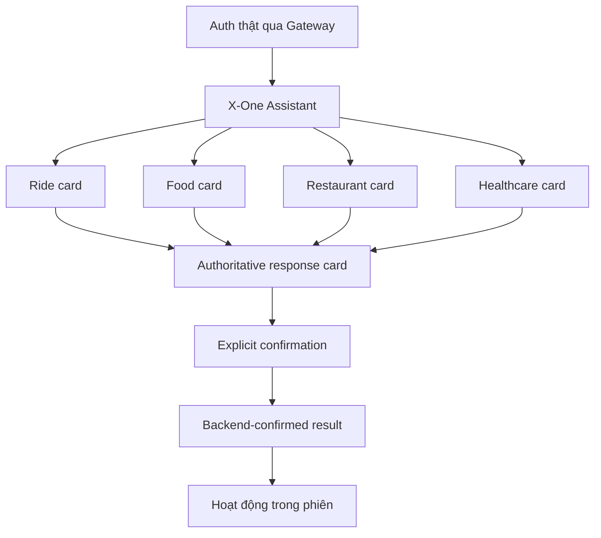

# X-One Web — Wireframe & UI Flow

Tài liệu này mô tả pre-demo frontend trong `apps/web/`. Web là một client mỏng
gọi NestJS API Gateway; không gọi Agent, domain service hoặc database trực tiếp.
Base URL lấy từ `import.meta.env.VITE_API_URL`, fallback `http://localhost:3000`
(`apps/web/src/api.ts`); bản build trong Compose được truyền
`VITE_API_URL=${WEB_API_URL:-/api}` nên dùng đường dẫn tương đối `/api` qua Nginx.
Bốn capability hiển thị trong UI là Ride, Food, Restaurant và Healthcare.

## Information architecture



App shell (`apps/web/src/App.tsx`) có đúng **ba** view điều hướng, không có tab "Dịch vụ" riêng:

1. **Trò chuyện** (`assistant`) — màn hình mặc định, chat-first. Các card Ride/Food/Restaurant/Healthcare xuất hiện ngay trong cuộc trò chuyện này theo yêu cầu, không có service selector tách riêng.
2. **Hoạt động gần đây** (`activity`) — chỉ các kết quả đã được Gateway xác nhận trong browser session hiện tại, giữ tối đa 40 mục trong state.
3. **Tài khoản** (`account`) — identity từ `GET /api/v1/auth/me`, trạng thái phiên và đăng xuất.

Sidebar có nút **Cuộc trò chuyện mới** (reset `chatKey`) và identity card + **Đăng xuất**. Trên mobile, ba view đó chuyển thành bottom navigation với nhãn ngắn (`Trò chuyện` / `Hoạt động` / `Tài khoản`).

## Authentication

```text
+-------------------------------------------------------+
| X-One                                               |
| Một trợ lý. Mọi dịch vụ hằng ngày.                  |
|                                                     |
| +---------------- Login ---------------------------+ |
| | Email                                             | |
| | Mật khẩu                                          | |
| | [Đăng nhập]                                       | |
| +--------------------------------------------------+ |
+-------------------------------------------------------+
```

Frontend gọi `POST /api/v1/auth/login`, lấy `access_token` và identity
`user.sub/email/role`, sau đó xác nhận bằng `GET /api/v1/auth/me`. Token chỉ nằm
trong memory và `sessionStorage`; không có tab đăng ký giả. Nếu Gateway trả 401,
frontend xóa phiên và quay lại màn hình đăng nhập.

## X-One Assistant

```text
+----------------------------+-------------------------------------------+
| X-One  Trợ lý hằng ngày    | Bạn muốn làm gì hôm nay?                  |
| [+ Cuộc trò chuyện mới]    | Các card Ride/Food/Restaurant/Healthcare  |
| [Trò chuyện]               +-------------------------------------------+
| [Hoạt động gần đây]        | Chat bubbles                              |
| [Tài khoản]                | Authoritative workflow card               |
|                            |                                           |
| identity + Đăng xuất       +-------------------------------------------+
|                            | Composer [Nhập yêu cầu…]          [Send]  |
+----------------------------+-------------------------------------------+
```

Tin nhắn có role, domain, timestamp và payload cấu trúc tùy chọn. Text luôn được
hiển thị trước; payload lạ chỉ rơi về summary an toàn. Workflow state và ID nội
bộ do Gateway giữ; Web chỉ nhận response consumer và action id:

```text
conversation -> conversation_id
action       -> action_id + stable Idempotency-Key per current session
cards        -> authoritative consumer fields only
```

Đổi yêu cầu không xóa kết quả đã hoàn tất của domain trước. Enter gửi, Shift+Enter
xuống dòng; lỗi giữ lại nội dung để retry.

## Domain cards trong Assistant

Assistant không yêu cầu người dùng chọn domain trước. Agent/Gateway tách nhiệm vụ
từ ngôn ngữ tự nhiên và trả card authoritative tương ứng:

| Domain | Ví dụ prompt | Kết quả hiển thị |
| --- | --- | --- |
| Ride | Từ sân bay Nội Bài đến Hoàn Kiếm bằng xe 4 chỗ | quote, booking, tài xế |
| Food | Tìm phở bò dưới 100 nghìn ở Hà Nội | quán, món, giỏ, preview, order |
| Restaurant | Đặt bàn cho 2 người tối mai ở Hà Nội | candidate, availability, hold, reservation |
| Healthcare | Tôi bị mệt và muốn đặt lịch khám | khoa, bác sĩ, slot, appointment |

Các prompt gợi ý chỉ là nội dung khởi đầu; chúng không tạo giá, nhà hàng, món ăn,
xe hay trạng thái đặt chỗ ở phía trình duyệt.

## Workflow confirmation flows

The current Web surface uses one conversation boundary:
`POST /api/v1/assistant/chat` for planning/authoritative cards and
`POST /api/v1/assistant/actions` for explicit actions. The domain-specific routes
below remain documented service/legacy workflow surfaces; the Web does not call
them directly.

### Ride

```text
POST /api/v1/chat
  -> quote card
  -> Xác nhận chuyến
POST /api/v1/workflows/{workflowId}/confirm-service
  -> AWAITING_PAYMENT_CONFIRMATION
  -> Xác nhận thanh toán demo
POST /api/v1/workflows/{workflowId}/confirm-payment
  -> COMPLETED / DRIVER_ASSIGNED
```

UI không tự tạo giá, booking ID hoặc trạng thái thành công. Chỉ response cuối của
Gateway mới tạo activity Ride.

### Food

```text
POST /api/v1/conversations/{conversationId}/messages
  -> tìm quán / chọn món / địa chỉ / xem tổng
  -> pending_confirmation: PLACE_FOOD_ORDER
  -> Xác nhận đặt món
POST /api/v1/confirmations/{confirmationId}/execute
  -> order + payment thật từ Gateway sandbox
  -> bounded read của /api/v1/food/orders/{orderId}
```

Confirmation dùng card payment và một `Idempotency-Key` ổn định cho mỗi action;
retry dùng lại đúng key.

### Restaurant

```text
POST /api/v1/restaurant-workflows/chat
  -> search -> availability -> hold
  -> CONFIRMATION_REQUIRED
  -> Xác nhận đặt bàn
POST /api/v1/restaurant-workflows/confirm
  -> reservation CONFIRMED
```

Card xác nhận hiển thị tên/địa điểm authoritative, mã đặt bàn, số khách và thời
gian do Gateway trả về. Frontend không bypass trạng thái `CONFIRMATION_REQUIRED`.

### Healthcare

```text
POST /api/v1/healthcare-workflows/chat
  -> departments -> doctors/slots -> hold
  -> PAYMENT_REQUIRED
  -> Thanh toán demo
POST /api/v1/healthcare-workflows/payment
  -> payment acknowledgement + appointment
  -> lấy confirmation cuối qua chat
  -> Xác nhận đặt lịch
POST /api/v1/healthcare-workflows/confirm
  -> appointment CONFIRMED
```

Payment được gắn nhãn sandbox. UI chỉ dùng doctor/slot/appointment ID đã nhận từ
backend; không tự suy đoán availability hoặc giá.

## Loading, error và offline

- Không có backend-status indicator: `apps/web/src/` không gọi `GET /health/ready` ở đâu cả. Sức khỏe stack là việc của launcher (`scripts/start-all.*`), không phải của header. Đừng mô tả một đèn xanh "Backend ●" trong UI vì nó không tồn tại.
- Mỗi lượt gửi có typing state; nút confirmation bị khóa trong lúc request chạy.
- Error hiển thị code/detail an toàn, không hiển thị stack trace hoặc object thô. `api.ts` nhận diện `ACTION_NOT_AVAILABLE`, `SELECTION_EXPIRED`, `IDEMPOTENCY`, `NO LONGER AVAILABLE` để đưa ra thông báo an toàn.
- Retry giữ message và confirmation/idempotency key cần thiết.
- Một lỗi không xóa các message hoặc kết quả trước đó.
- Gateway trả `401` ⇒ `api.ts` xóa token khỏi `sessionStorage` và app quay về màn hình đăng nhập.

## Hoạt động trong phiên

Không có unified history endpoint trong public Gateway hiện tại. Vì vậy Activity
chỉ chứa kết quả backend-confirmed trong tab hiện tại và không được gọi là lịch sử
tài khoản đầy đủ. Không có booking/order giả từ local state.

## Responsive direction

- Desktop: sidebar cố định, chat chính, card render trong luồng hội thoại.
- Tablet/mobile: một cột, `mobile-header` gọn ở trên, composer ở cuối, navigation
  chuyển thành bottom navigation ba mục.
- UI dùng system font, nền slate trung tính, surface trắng, border 1px, radius
  vừa phải và icon Lucide; không phụ thuộc font network hay ảnh minh họa.

Đây là frontend demo tích hợp với local Gateway. Demo authentication và payment
sandbox là development-only; production identity, provider payment và deployment
không nằm trong phạm vi tài liệu này.
