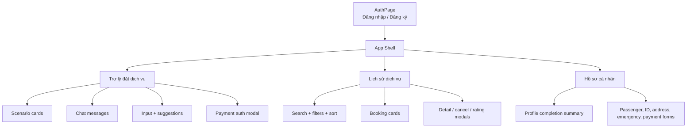
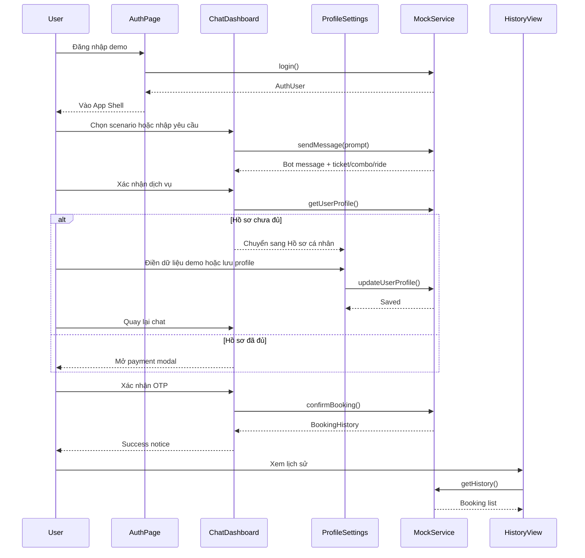

# Wireframe & UI Flow - NaviGo Frontend Demo

Tài liệu này mô tả wireframe và UI flow cho demo NaviGo trong `apps/web/`. Mục tiêu là giúp reviewer hiểu nhanh màn hình, navigation và các luồng đặt dịch vụ đang được mock trong frontend.

## Information Architecture



## Screen 1 - Authentication

```text
+--------------------------------------------------------------+
| NaviGo Admin                                                 |
| Quản trị vận hành đặt dịch vụ                                |
|                                                              |
| +---------------- Auth Card ----------------+                 |
| | [Đăng nhập] [Đăng ký]                    |                 |
| | Email                                    |                 |
| | Mật khẩu                                 |                 |
| | [Đăng nhập]                              |                 |
| | [Admin demo] [User demo]                 |                 |
| +------------------------------------------+                 |
+--------------------------------------------------------------+
```

**Purpose:** Cho phép reviewer vào demo nhanh bằng tài khoản mẫu hoặc tạo user local.  
**Primary actions:** Đăng nhập, đăng ký, đăng nhập nhanh bằng Admin demo/User demo.  
**State:** Loading khi xác thực, error nếu email/mật khẩu sai.

## Screen 2 - App Shell

```text
+----------------------+---------------------------------------+
| NaviGo               | Topbar: tên tab + trạng thái hồ sơ    |
|                      +---------------------------------------+
| [Trợ lý đặt dịch vụ] |                                       |
| [Lịch sử dịch vụ]    | Content area theo tab đang chọn       |
| [Hồ sơ cá nhân]      |                                       |
|                      |                                       |
| User menu            |                                       |
+----------------------+---------------------------------------+
```

**Purpose:** Giữ navigation ổn định, tránh làm trôi sidebar/topbar khi chat dài.  
**Primary actions:** Chuyển tab, mở hồ sơ, mở lịch sử, đăng xuất.

## Screen 3 - Chat Dashboard

```text
+--------------------------------------------------------------+
| Scenario cards: Vé đơn | Combo | Đổi vé | Đặt xe             |
+--------------------------------------------------------------+
| Success/warning notice                                      |
+--------------------------------------------------------------+
| Chat list                                                    |
|  Agent: Tôi có thể giúp bạn đặt vé...                       |
|  User: Tôi muốn đặt vé máy bay...                           |
|  Agent: TicketCard / ComboCard / RideOptions / HandoffCard  |
|                                                              |
|                              [Tin nhắn mới nhất]             |
+--------------------------------------------------------------+
| Suggestions chips                                           |
| [Input yêu cầu đặt dịch vụ...]                       [Send]  |
+--------------------------------------------------------------+
```

**Purpose:** Demo agent hỗ trợ đặt dịch vụ đa nền tảng bằng hội thoại.  
**Primary actions:** Chọn scenario, nhập prompt, chọn combo, chọn xe, xác nhận thanh toán, yêu cầu đổi phương án.  
**State:** Loading bubble, warning khi thiếu hồ sơ, success notice sau khi tạo booking.

## Screen 4 - Payment Authentication Modal

```text
+---------------- Payment Modal -------------------------------+
| Xác thực Thanh toán Dịch vụ                            [X]   |
| Booking summary: provider, route, amount                    |
|                                                              |
| Phương thức: [MoMo] [Thẻ] [VietQR]                           |
|                                                              |
| MoMo OTP / 3D-Secure OTP / VietQR placeholder                |
|                                                              |
| [Hủy bỏ]                         [Xác nhận OTP & Hoàn tất]  |
+--------------------------------------------------------------+
```

**Purpose:** Minh họa bước xác thực thanh toán sandbox trước khi tạo booking.  
**Primary actions:** Chọn phương thức thanh toán, nhập OTP demo, hoàn tất giao dịch.  
**State:** Verifying, disabled khi thiếu OTP, success notice sau khi confirm.

## Screen 5 - Profile Settings

```text
+----------------------+---------------------------------------+
| Profile summary      | Hồ sơ cá nhân                         |
| Avatar, email        | [Điền dữ liệu demo]                   |
| Completion progress  |                                       |
| Checklist demo       | Thông tin liên hệ                     |
|                      | Giấy tờ tùy thân                      |
|                      | Địa chỉ liên hệ                       |
|                      | Liên hệ khẩn cấp                      |
|                      | Tùy chọn đặt dịch vụ                  |
|                      | Cài đặt thông báo                     |
|                      | [Hủy thay đổi] [Lưu thay đổi]         |
+----------------------+---------------------------------------+
```

**Purpose:** Thu thập dữ liệu hành khách bắt buộc trước khi thanh toán.  
**Primary actions:** Điền demo profile, sửa thông tin, lưu thay đổi, chọn phương thức thanh toán mặc định.  
**Validation:** Email, số điện thoại, CCCD/CMND, ngày sinh, trường bắt buộc.

## Screen 6 - Booking History

```text
+--------------------------------------------------------------+
| Hero: Lịch sử đặt dịch vụ + doanh thu đã thanh toán          |
+--------------------------------------------------------------+
| Summary cards: Tổng booking | Sắp tới | Hoàn thành | Đã hủy  |
+--------------------------------------------------------------+
| Search input                                  Sort dropdown  |
| Status filters                                                |
| Service type filters                                          |
+--------------------------------------------------------------+
| Booking cards                                                 |
| Icon | Provider | Route | Date/time | Payment | Status       |
|                                      [Chi tiết] [Hủy/Đánh giá]|
+--------------------------------------------------------------+
```

**Purpose:** Quản lý booking sau khi đặt thành công.  
**Primary actions:** Tìm kiếm, lọc, sắp xếp, xem chi tiết, hủy booking, đánh giá dịch vụ.  
**State:** Empty state khi filter không có kết quả, modal chi tiết/hủy/đánh giá.

## Main User Flow



## Demo Scenarios

| Scenario | User intent | UI output | Completion path |
|----------|-------------|-----------|-----------------|
| Đặt vé máy bay | Tìm vé Hà Nội - Đà Nẵng | TicketCard | Xác nhận hồ sơ, OTP, tạo booking |
| Combo trọn gói | Bay + khách sạn | Combo cards | Chọn combo, OTP, tạo hai booking liên kết |
| Đổi vé & hoàn tiền | Đổi sang tàu hỏa | Reschedule comparison | Xác nhận đổi lịch, ghi nhận hoàn tiền mock |
| Đặt xe & chọn xe | Xe đưa đón sân bay | Ride option cards | Chọn loại xe, xác nhận thanh toán |
| Handoff CSKH | Giao dịch cần hỗ trợ | Handoff card | Operator mock tiếp quản phiên chat |

## UI States Checklist

| Area | State | Expected behavior |
|------|-------|-------------------|
| Auth | Loading | Disable button, hiển thị spinner |
| Auth | Error | Hiển thị lỗi đăng nhập/đăng ký |
| Chat | Loading response | Hiển thị bubble "Đang xử lý..." |
| Chat | Long conversation | Chỉ chat list scroll, sidebar/topbar giữ vị trí |
| Chat | Missing profile | Hiển thị warning và chuyển sang hồ sơ |
| Payment | Verifying | Disable confirm button, hiển thị spinner |
| Payment | Success | Đóng modal, tạo booking, hiện CTA xem lịch sử |
| Profile | Invalid form | Hiển thị lỗi từng trường |
| Profile | Saved | Cập nhật pill "Hồ sơ sẵn sàng" |
| History | Empty filters | Hiển thị empty state |
| History | Modal open | Focus vào dialog chi tiết/hủy/đánh giá |

## Documentation References

| Document | Location | Notes |
|----------|----------|-------|
| Project Build Phase PDF | `docs/Project Build Phase.docx.pdf` | Tài liệu yêu cầu/deliverable gốc của dự án |
| Architecture diagram | `docs/architecture_diagram.md` | Sơ đồ hệ thống, component và deployment hiện tại |
| UI wireframe & flow | `docs/ui_wireframe_flow.md` | Tài liệu màn hình, user flow và UI states |
